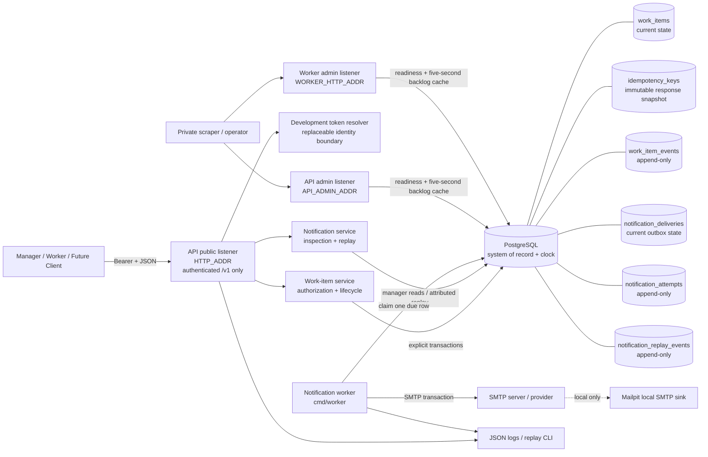

# Architecture Overview

## Component architecture



The API and worker are independently runnable processes but share one module, domain vocabulary, schema, release image, and operational conventions. The API pre-binds both sockets before either starts serving; if the administrative bind fails, the public listener is closed. Both API servers drain concurrently under one shutdown budget. A worker signal separately stops new claims, drains its active SMTP/database attempt while shutting down the admin listener, and force-cancels only after that budget; both goroutines are reaped before database close or return.

Direct execution uses loopback defaults for the two administrative listeners. Compose uses wildcard binds inside the containers so forwarding works, while publishing every host port explicitly on `127.0.0.1`. Administrative health and metrics routes are unauthenticated, are absent from the public OpenAPI document, and need a private network boundary outside local development.

## Assignment and notification sequence

```mermaid
sequenceDiagram
    autonumber
    actor Manager
    participant API as Public HTTP API
    participant Domain as Work-item service
    participant DB as PostgreSQL
    participant Worker as Notification worker
    participant SMTP as SMTP server

    Manager->>API: PUT /v1/work-items/{id}/assignment<br/>Bearer + If-Match
    API->>Domain: Assign(authenticated actor, assignee, version)
    Domain->>DB: BEGIN
    Domain->>DB: Load item and assignee
    Domain->>Domain: Authorize + validate lifecycle
    Domain->>DB: Conditional work_items UPDATE
    Domain->>DB: INSERT append-only assignment event
    Domain->>DB: INSERT unique PENDING delivery + stable Message-ID
    Domain->>DB: COMMIT
    Domain-->>API: current item
    API-->>Manager: 200 + ETag

    loop Up to the configured per-poll send limit
        Worker->>DB: BEGIN; fetch clock_timestamp() once;<br/>lock at most one row from each ordered partial index
        Worker->>Worker: choose earliest eligibility / created_at / id
        Worker->>DB: Set owner + fresh DB UUID token<br/>attempt + lease expiry; COMMIT
        Worker->>SMTP: EHLO / optional TLS + AUTH / MAIL / RCPT / DATA
        alt SMTP rejects or transport fails
            SMTP-->>Worker: failure
            Worker->>DB: Conditional fenced update<br/>safe allowlisted code/message + attempt
        else SMTP accepts completed DATA
            SMTP-->>Worker: 250 accepted
            Note over Worker,DB: Crash here can cause a later duplicate
            Worker->>DB: Mark SENT + append SENT attempt only if<br/>owner, token, attempt and unexpired lease still match
        end
    end

    opt Worker dies with a live lease
        Note over DB: PostgreSQL clock reaches lease expiry
        Worker->>DB: Another worker records ABANDONED<br/>and claims with a fresh token
    end
```

Assignment never waits for SMTP. The item update, event, and initial outbox row either commit together or all roll back. Before opening a connection, the adapter builds the complete MIME payload, folds variable headers at structured boundaries, quoted-printable encodes the full body, and enforces the 998-octet physical-line ceiling. One sticky 1 MiB raw-transport read budget bounds the peer-controlled SMTP/TLS input across the complete connection, including a STARTTLS upgrade. `SENT` means the configured SMTP server accepted the completed message transaction; it does not establish inbox placement or final delivery. If acceptance occurs and the worker dies before the fenced database update, recovery can resend the stable `Message-ID`. Generic SMTP is therefore intentionally at least once.

Only an allowlisted failure code and fixed generic message are persisted or returned. Provider text, certificate details, authentication responses, and credentials are not durable notification data.

## Idempotency and concurrency ownership

- Create requires an actor/operation/key/request-hash record whose first committed response JSON is immutable. A matching replay returns that snapshot even if related rows later change; key reuse with a different payload fails.
- Assignment, start, and complete use expected versions. A stale command fails rather than silently overwriting another actor.
- Same-assignee and same-target-state repeats are deterministic no-ops and do not append duplicate events or deliveries.
- The worker lease token is an internal database fence. It is deliberately absent from manager API representations.
- Notification replay is a reasoned operator action: the state change and an append-only replay event commit atomically, with authenticated manager/request attribution over HTTP or a clearly self-asserted operator identity through the database-access CLI. Delivery cycles stop at 10.

## Data and query ownership

- `work_items` is current operational state; creator and completed state are database-protected.
- `work_item_events`, `notification_attempts`, and `notification_replay_events` are append-only histories.
- `notification_deliveries` owns current delivery, retry, safe-error, cycle, schedule, and lease state.
- Notification detail reads current delivery, attempts, and replay events inside one read-only `REPEATABLE READ` transaction so one response cannot mix histories committed after its current-state snapshot.
- PostgreSQL `clock_timestamp()` controls due checks, lease validity, completion fencing, recovery, retry, and replay scheduling; process clocks do not decide persisted eligibility.
- Work-item and notification lists use keyset indexes over their documented sort boundaries. History uses item sequence order. Large default-planner tests traverse tied pages and reject sequential scans and sort nodes while requiring the matching notification page index. Claim-plan tests similarly require both ordered partial indexes.
