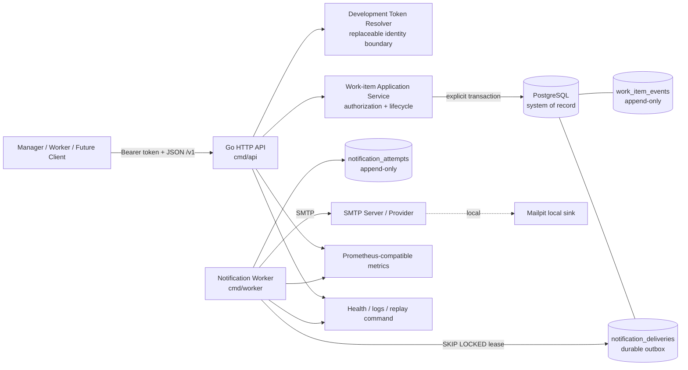
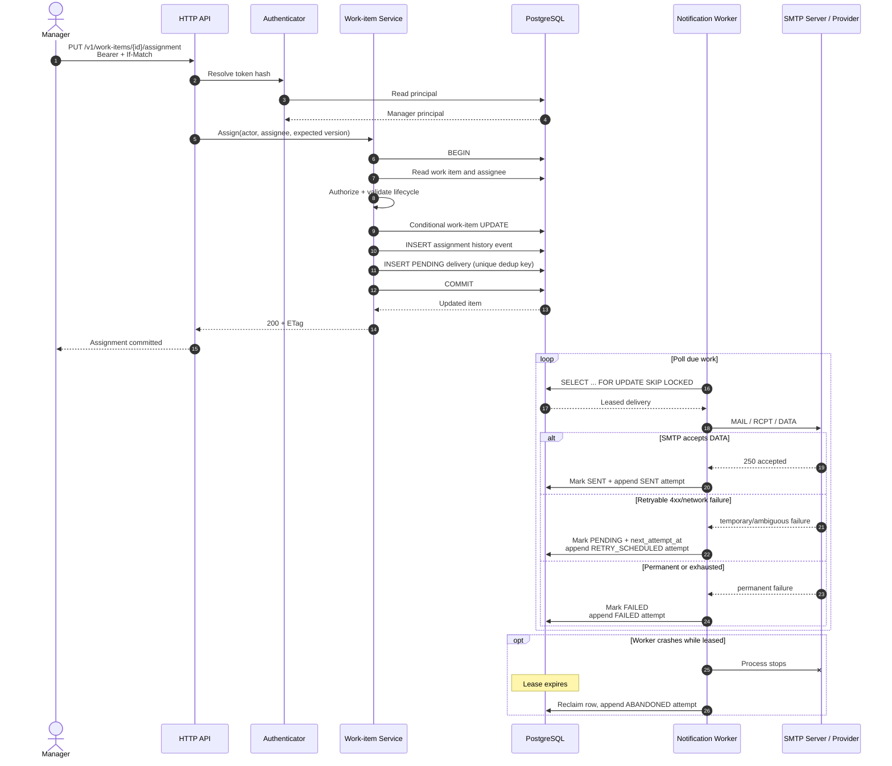

# Architecture Overview

## Component architecture

The API and worker are independently runnable processes but share one module, domain vocabulary, schema, release artifact, and operational conventions.

## Assignment and notification sequence

## Data ownership

- `work_items` is the current state optimized for operational reads.
- `work_item_events` is append-only mutation history.
- `notification_deliveries` is current delivery/lease/retry state.
- `notification_attempts` is append-only attempt history.
- Assignment update, assignment event, and initial delivery insert are one database transaction.
- Email transport never runs inside that transaction.
